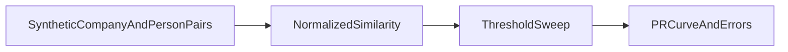

1. Match company/person records across messy sources, measure precision/recall, show tradeoffs.

2. Result:
   Labeled synthetic pairs: 600  
   Precision at threshold 0.9: 1.0  
   Recall at threshold 0.9: 0.7766666666666666  

   Measured with `make bench`: [raw results](evidence/bench.json), [command output](evidence/checks.log), [environment](evidence/environment.json).

3. Architecture:


4. Run it:
```sh
make setup
make lint test bench
make demo
```

5. Decisions and limits: All company/person records and domains are synthetic; no real PII. Labels are retained only for evaluation, not used by the matcher. Candidate pairs deliberately include similar names, changed domains, old cities and near-collision negatives. The fixed threshold is declared rather than optimized on this test set. evidence/precision-recall.svg and evidence/precision-recall.json show the full sweep; evidence/error-analysis.md exposes actual false positives/negatives. This pairwise harness does not claim scalable candidate generation, global entity resolution or calibrated match probabilities.

6. Next: Add independent synthetic distributions, blocking strategies and subgroup-specific error analysis.
